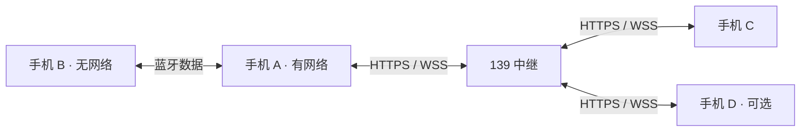

# 蓝牙对讲

四人 Android 全双工对讲测试版。每部手机连接自己的耳机；附近手机优先经经典蓝牙 RFCOMM 传输语音，也可通过 139 服务器组队。有网队友能为没网的蓝牙队友转发语音和组队消息。

- [下载 Android 测试 APK](https://home.sunny-string.cn/ble-talkie/download)
- [服务入口](https://home.sunny-string.cn/ble-talkie/)
- [健康检查](https://home.sunny-string.cn/ble-talkie/healthz)

支持 64 位 Android 10 及以上设备，APK 包含 arm64-v8a 和 x86_64。当前采用开发签名，适合首轮设备测试。直接安装同签名更新包可保留本机队伍凭据，卸载会删除这些凭据。

## A、B、C 如何组队

1. 三部手机安装 App，并各自连接一套耳机。
2. 有网络的 A 填写昵称、创建队伍，点击“可被发现”，允许系统蓝牙权限和发现请求。
3. 没网络的 B 点击“附近找人”，连接 A；按系统提示完成蓝牙配对。A 在入队申请中同意 B 加入。
4. 远程 C 输入 A 分享的 16 位组队码，或扫描邀请二维码申请加入；组队码区分大小写。A 确认申请。第四位成员可走蓝牙或网络。
5. 每个成员点击“开始通话”。队友可以同时讲话，点击“关闭麦克风”可静音。界面显示当前路径和实际麦克风、播放设备。



B 不需要开启共享上网。A 的 App 代理 B 的语音和组队消息，服务器仍将 B 识别为独立成员。A 失去网络时，已连接的本地蓝牙队友可继续互通；远程成员暂时不可达。B 的蓝牙断开后，有自己的网络就尝试中继，没有其他可达路径则显示离线。

## 手动更换网关

已在同一队伍中的有网成员，可以选择“让这台手机做网关”，然后开启“可被发现”。其他成员在附近列表中选择该手机，点击“连接当前队友”。切换前原有蓝牙队友会断开，需要手动选择新的网关；首版提供短暂中断后的重连，不承诺整队无感迁移。

队长也可以经队友的蓝牙网关审批远程申请。管理操作针对当前网关会话签名，网关不持有队长的管理密钥。纯离线新队伍首次接入远程队友时，需要先由队长联网完成云端登记。

## 权限与运行

- 找人、连接和可被发现时分别请求对应蓝牙权限；Android 10/11 搜索还要求系统位置权限与位置开关。
- 麦克风仅在主动开始通话后启用。耳机通话链路断开或音频焦点被其他通话占用时暂停麦克风，确认设备后可重新开始。
- 前台通知保留队伍与网关连接；通知中可以结束通话或退出队伍。
- 组队码只能申请入队，队长批准前不能订阅语音。移除成员后撤销其语音权限。
- 服务仅转发实时语音，不保存录音。队伍在创建 24 小时后过期，届时需要重新创建；未完成的入队申请在 10 分钟后过期。

## 构建与验证

Android 使用 Gradle 9.5、AGP 9.3、SDK 36、NDK 28.2.13676358、CMake 3.22.1。构建时配置 Android SDK 路径；本地 `android/local.properties` 不提交。Opus 1.5.2 源码归档与 SHA-256 已固定在仓库内，首次构建仍需下载 Maven 依赖。

```powershell
$env:JAVA_HOME = 'C:\Program Files\Android\Android Studio\jbr'
$env:ANDROID_HOME = "$env:LOCALAPPDATA\Android\Sdk"
.\android\gradlew.bat -p android :app:testDebugUnitTest :app:assembleDebug :app:lintDebug
```

APK 输出：`android/app/build/outputs/apk/debug/app-debug.apk`。

```powershell
Set-Location server
go test ./...
go vet ./...
```

独立 Android 端到端测试 APK 使用合成音频和测试成员，验证真实公网 WSS、代理来源、原生解码与混音和在线退队撤权。只在专用测试设备或模拟器上运行，它会创建并清理测试队伍。下面的 `adb` 需已加入命令搜索路径：

```powershell
.\android\gradlew.bat -p android :app:assembleDebugAndroidTest
adb -s emulator-5556 install -r android/app/build/outputs/apk/debug/app-debug.apk
adb -s emulator-5556 install -r android/app/build/outputs/apk/androidTest/debug/app-debug-androidTest.apk
adb -s emulator-5556 shell pm grant cn.sunnystring.bletalkie android.permission.RECORD_AUDIO
adb -s emulator-5556 shell am instrument -w cn.sunnystring.bletalkie.test/cn.sunnystring.bletalkie.FlowProbeInstrumentation
```

已通过 34 项 Go 测试、18 项 Android 核心单元测试、Android lint/构建、模拟器原生 Opus 探针和公网客户端链路测试；端到端合成音频测试收到并解码了全部 200 帧远端语音。真机 USB 安装已按用户要求暂缓；**尚未验证真实耳机与多条手机蓝牙连接的并发、真实三/四手机通话、声学质量、端到端延迟和 30 分钟稳定性目标**。

部署说明见 [deploy/README.md](deploy/README.md)，协议见 [docs/protocol-v1.md](docs/protocol-v1.md)，设计与验收目标见 [设计文档](docs/superpowers/specs/2026-11-01-hybrid-talkie-design.md)。
