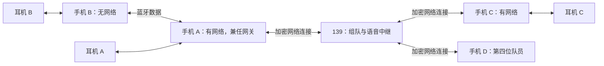

# 四人蓝牙与网络混合对讲设计

日期：2026-11-01。状态：用户已批准并实现首版测试软件；公网中继与 Android 构建、模拟器客户端链路已验证，真实多机蓝牙与耳机验收仍待进行。

## 1. 已确认的需求

- 首版支持一个队伍最多 4 人，每人一部 Android 手机，每部手机连接自己的蓝牙耳机。
- 全双工通话：队员可以同时讲话、听到其他队员。
- 手机之间优先使用蓝牙；蓝牙不可用时，有网络的成员通过 139 服务器通信。
- App 支持附近找人、邀请和确认组队，也支持远程加入同一个队伍。
- 离线成员 B 可以通过蓝牙连接有网络的成员 A，由 A 代理组队消息并转发语音到服务器，再到远程成员 C。反向链路同样成立。

## 2. 首版边界与推荐方案

推荐原生 Android App、经典蓝牙 RFCOMM 数据连接、Opus 语音编码和独立的 139 中继服务。蓝牙承担手机之间的数据传输，每部手机只需使用一套耳机的通话音频。

| 方案 | 优点 | 代价 | 选择 |
| --- | --- | --- | --- |
| Opus + RFCOMM + 加密 WebSocket 中继 | 蓝牙与网络可共用语音帧，便于代理离线成员和接入现有 HTTPS | 两种传输均可能因可靠重传产生排队延迟 | 首版采用，必须实测延迟 |
| Opus + RFCOMM + 加密数据报中继 | 网络侧可以丢弃过期包，降低丢包重传对实时性的影响 | 增加移动端传输集成、服务端监听和网络兼容工作 | 首版网络延迟不达标时评估 |
| WebRTC 网络通话 + 自定义蓝牙桥接 | 网络媒体栈成熟 | 需要把蓝牙成员映射为独立媒体源，增加桥接与协议适配 | 不作为首版方案 |

首版采用一个蓝牙中心节点连接至多三个成员的星形结构。具备互联网连接的中心节点充当网关。纯蓝牙队伍可离线通话；其他有网成员通过服务器加入。首版不做任意多跳蓝牙 Mesh，不做 iOS 和大文件传输。

4 人是软件与验收目标，不能据此推断所有手机都能稳定承载三条手机数据连接加一套耳机。真实连接能力必须通过对应机型的并发测试确认。

## 3. 用户给出的拓扑

- B 发言：B 编码 → 蓝牙 → A；A 本地播放，并把保留 B 身份的语音转给 139 → C、D。
- C 发言：C 编码 → 139 → A、D；A 本地播放，并经蓝牙送给 B。
- A 发言：A 编码后同时发送给蓝牙成员 B 和服务器，服务器转给 C、D。
- 第四位队员也可以经蓝牙连接 A，此时按同一套本地转发规则工作。

A 不需要为 B 提供系统级蓝牙共享上网。B 的 App 消息和语音由 A 的 App 代理，B 自身可以始终没有互联网连接。

## 4. App 与找人组队

首版使用昵称和本机持久化成员标识，不引入额外账号平台。

1. 首页显示耳机状态、创建队伍、附近找人、输入组队码或扫码加入。
2. 附近找人由用户主动发起蓝牙发现；设备建立连接后通过应用协议确认身份与兼容版本。连接前停止蓝牙发现，通话中不持续高频扫描。
3. 发现设备和加入队伍是两个步骤；对方确认邀请后才成为成员。系统要求的蓝牙配对与权限确认由 Android 完成。
4. 远程成员通过组队码或二维码申请加入，队长确认；组队码只是邀请入口，不能单凭知道队伍 ID 就订阅语音。
5. B 的加入申请、成员列表、邀请确认和退队消息均可通过 A 代理。服务器为 B 保留独立成员身份，不把 B 记成第二个 A。
6. 纯离线队伍由中心节点维护本地成员列表；中心节点联网后携带队伍所有权凭据和成员授权登记到服务器，远程成员再加入。
7. 队伍界面显示四个成员位、昵称、静音状态、当前连接方式和网关。断线后明确显示受影响成员的状态。

本地邀请携带随机队伍标识和成员授权凭据；联网后沿用同一队伍标识。设备标识、成员授权及房间访问凭据分别管理，不能仅信任消息中自报的昵称或 senderId。

实现中，队长经其他成员网关审批时，针对当前服务器连接挑战、成员路由代次和单次操作生成 HMAC 签名，网关不获取队长管理密钥。取消待审批申请会撤回服务器票据，避免无客户端领取凭据的成员占位。

## 5. 音频与传输

### 手机音频

- 每部手机选择本机的一套通话耳机，使用 Android 标准通信音频路由。
- 采集前明确显示正在使用的麦克风和播放设备。通过真实路由检查确认音频进入耳机，设备断开时提示并处理路由变化。
- 首版拟使用单声道 Opus、20 ms 一帧、16 kHz 编码采样率、约 24 kbit/s 目标码率；实际采集采样率跟随音频设备，再按需重采样。
- 每位成员的语音只在源手机编码一次。网关和服务器转发压缩帧，各接收手机按成员分别解码、缓冲并混合其他成员的音频。
- 丢弃自己来源的帧，混音做限幅；设备支持时启用平台回声与噪声处理，并以双人同时讲话实测效果。
- 通话通过前台服务运行，处理麦克风、附近设备权限和系统后台限制。录音服务由前台用户操作启动。

### 统一数据帧

语音封包携带协议版本、消息类型、队伍 ID、发送成员 ID、流实例 ID、序号、媒体时间戳与负载长度。语音、组队控制、心跳和路由通知使用明确区分的消息类型及长度边界。

保留原始发送者身份，去重键采用“队伍 ID + 成员 ID + 流实例 ID + 序号”。流重启时更新实例 ID，避免新一轮序号被误判成旧包。

### 蓝牙

使用带认证与加密的 RFCOMM Socket。每个连接可同时收发，网关维护独立成员会话和有界发送队列。蓝牙断开、权限撤销、配对拒绝和协议版本不兼容均返回明确状态。

Android 支持这一数据接口，不等于已经验证手机同时运行耳机通话与多条 RFCOMM 时的性能；此项是第一阶段的真机验证重点。

### 网络

首版客户端通过 TLS WebSocket 连接 139 独立中继入口，控制与语音使用分开的逻辑队列，避免成员管理被音频发送占满。服务端验证成员与代理授权、维护队伍和转发表、转发压缩帧，不转码。

实时语音使用有界队列和过期丢弃，控制消息独立确认。WebSocket/TCP 以及 RFCOMM 的底层重传仍可能阻塞后续数据，应用丢包策略不能消除这种阻塞；必须以弱网验收结果决定是否升级网络传输。

连接握手、心跳、断线检测和退避重连相互独立。端点、端口及凭据通过配置提供，不在 App 或仓库中写死生产秘密。

## 6. 转发、切换与异常

- 同一成员对之间，健康蓝牙路径优先；不可用时再选择可达的网关或服务器路径。
- 有网成员的网络会话可保持待命，但待命连接不重复订阅同一成员已经通过蓝牙收到的音频。
- 网关可以在一个上行会话中代理多个逻辑成员，服务器验证每个被代理成员的授权，并记录各自的有效入口。
- 本地转发和服务器转发都按当前拓扑定向分发，不能无条件广播回入站连接。服务器对来自同一网关的成员只向其他有效上行会话发送一次；网关再向需要接收的本地成员分发。
- 切换时更新带代次的成员路由，短暂重叠依靠语音去重处理。旧入口失效后不继续发送，也不积压陈旧语音等待重连。
- 若 B 的蓝牙断开且 B 本身无网络，也没有另一个可达网关，B 显示离线；网络回退不能创造不存在的连接。
- A 失去互联网时，仍与 A 蓝牙相连的成员继续本地通话，远程成员暂时不可达；恢复上行后重新同步成员与路由。
- 已配对且获授权的其他成员可在用户选择后替换网关。首版不承诺无感的跨网关迁移，也不自动搜索任意多跳路径。
- 邀请拒绝、满员、离队、被移除和凭据失效需要同步到本地成员及服务器，移除成员后停止转发其语音。

## 7. 139 服务部署边界

已通过现有 SSH 配置完成只读连接与资源检查，确认目标服务器存在。现有 HTTPS 及其他业务正在运行。

用户已指定使用现有 `home.sunny-string.cn` 的独立路径。公网基础入口固定为 `https://home.sunny-string.cn/ble-talkie/`；API 使用 `/ble-talkie/api/`，语音连接使用 `/ble-talkie/ws`，健康检查使用 `/ble-talkie/healthz`。后端与代理均保留该前缀，邀请链接同样包含此前缀。

对讲中继采用独立 Go 进程、监听地址和配置，通过现有 HTTPS 与独立 Nginx 片段接入。健康检查正常时返回 `200 {"status":"ready"}`；APK、邀请、API 和 WebSocket 均由保留前缀的代理转发。部署约定见 [deploy/README.md](../../../deploy/README.md)。

语音默认只做实时转发，不保存录音。服务器日志记录连接、成员状态和聚合延迟指标，避免记录访问凭据和语音内容。

## 8. 分阶段交付与验收

### 阶段一：验证两手机蓝牙全双工

两台真实 Android 手机各连接一套耳机，经 RFCOMM 同时收发语音。连续通话至少 10 分钟，包含双人同时讲话、静音和耳机断连。确认音频路由、收发带宽、延迟和稳定性，不能只用模拟器或数据回环代替。

### 阶段二：完成 A/B/C 混合链路

B 关闭 Wi-Fi 和蜂窝数据但保留蓝牙；A 与 C 有网络。三人可以同时讲话，B 能通过 A 加入队伍，C 的语音可经 139、A 到 B。检查每个来源均可听见，且没有自身回放、重复播放或转发循环。

### 阶段三：四人、组队和切换

验证四人纯蓝牙星形、两人蓝牙加两人网络等组合。完成附近找人、邀请接受/拒绝、远程加入、满员限制、离队、断线重连和网关替换。成员连接方式要与实际路径一致。

### 初始质量目标

- 四人队伍连续全双工通话 30 分钟，App 无崩溃和无界缓冲增长。
- 稳定无线与网络条件下，单向端到端音频延迟以中位数不超过 300 ms、95 分位不超过 700 ms 为初始验收目标；这些是待实测的目标，不是已验证能力。
- 断路后及时显示状态；存在备用路径时切换后恢复语音，不回放断线期间积压音频。首版允许切换产生短暂中断，恢复时长实测记录。
- 注入重复包、过期包、乱序和路由变更，验证去重、过期丢弃、成员授权及转发边界。
- 在实际需要同时承担耳机与多手机蓝牙连接的机型上验收；当前仅检测到一台 ADB 手机，三机链路与四人上限尚不能验收。

## 9. 证据与未确认项

已确认：现有连接手机为小米 13、Android 16，具备经典蓝牙、BLE 与麦克风能力；Android SDK 的 BluetoothSocket 提供双向输入输出流及 RFCOMM 数据连接。参考 [Android BluetoothSocket API](https://developer.android.com/reference/android/bluetooth/BluetoothSocket)。

尚需真机确认：耳机通话与手机数据连接的并发稳定性、三条蓝牙成员连接的可用性、端到端延迟、后台运行和各厂商路由差异。网络侧 WebSocket 弱网延迟也需实测。

首版实现顺序为“两手机蓝牙语音 → 三手机混合转发 → 四人组队与路径切换”，每阶段通过对应验收后进入下一阶段。
